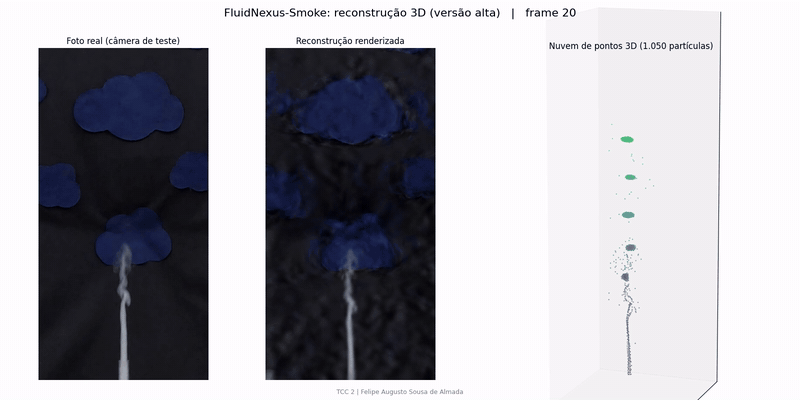
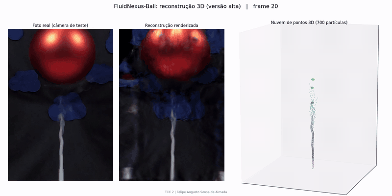
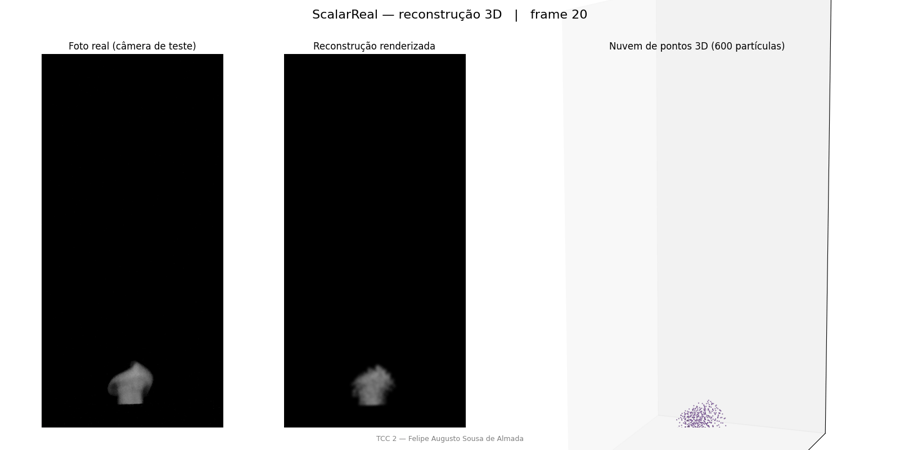
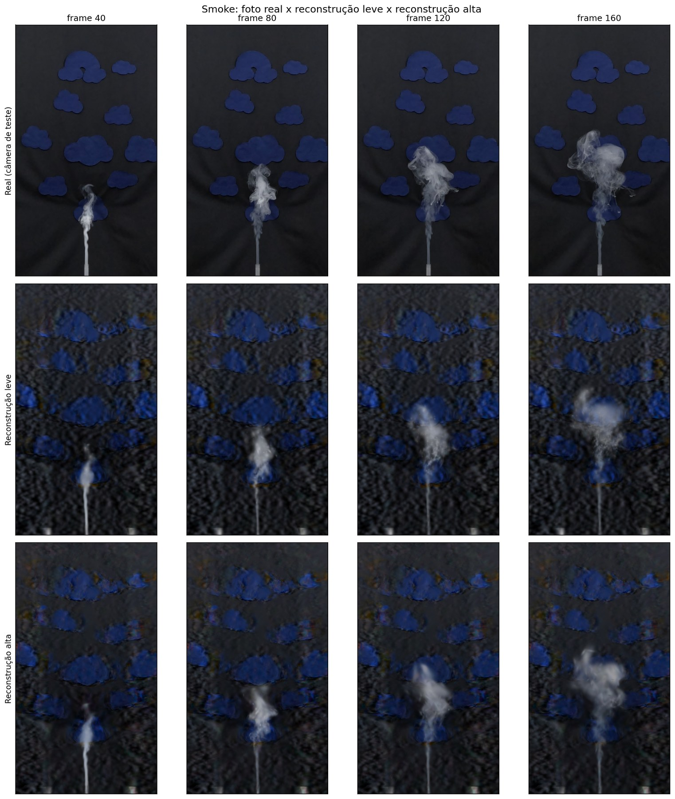
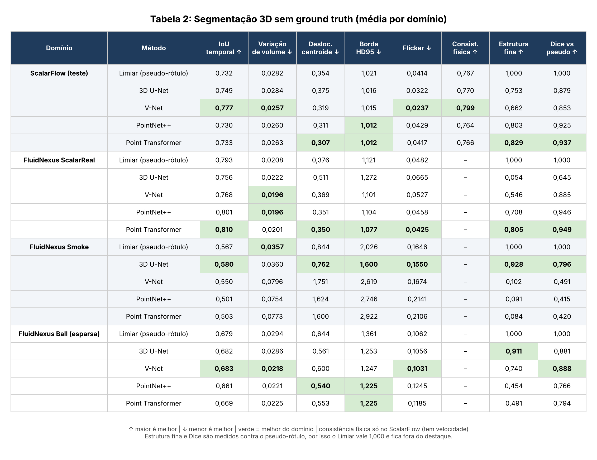
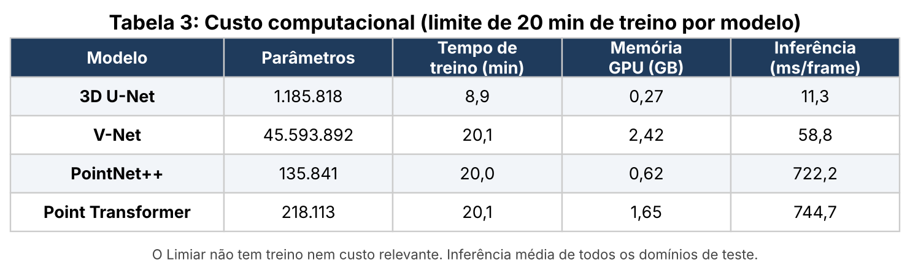
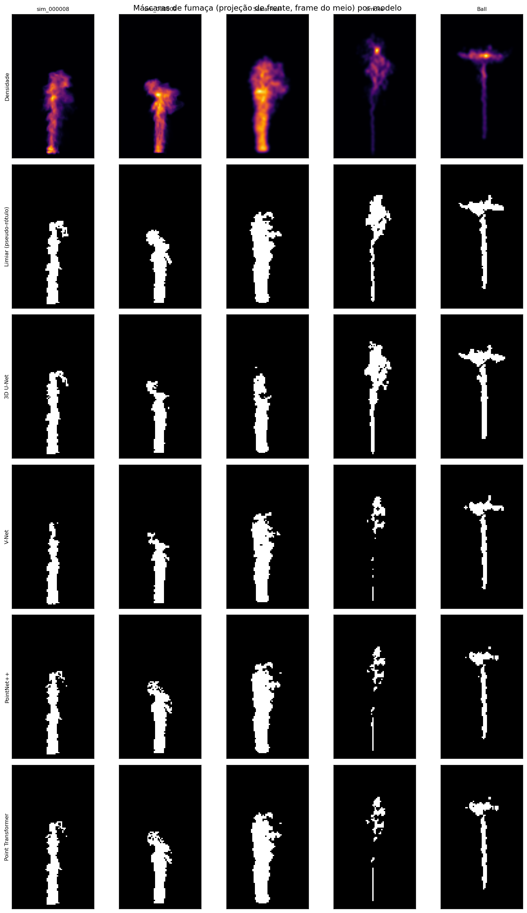

# FluidNexus TCC 2

Reconstrução 3D de fumaça e segmentação 3D sem ground truth.
Trabalho de Conclusão de Curso 2 em Engenharia da Computação (UFMA).

## Autoria

**Autor:** Felipe Augusto Sousa de Almada
**Orientador:** Prof. Haroldo

Este projeto acadêmico possui apenas o autor identificado acima.

## Objetivo

1. Reconstruir fumaça em 3D a partir de vídeos multivista com o [FluidNexus](https://github.com/ueoo/FluidNexus) e comparar uma configuração leve com a configuração oficial (alta).
2. Segmentar a fumaça em 3D **sem ground truth** e comparar quatro arquiteturas (3D U-Net, V-Net, PointNet++ e Point Transformer) com métricas de estabilidade temporal e consistência física.

## Dados

| Conjunto | Uso |
|---|---|
| FluidNexus ScalarReal | reconstrução 3D e teste da segmentação |
| FluidNexus Smoke | reconstrução 3D e teste da segmentação |
| FluidNexus Ball | reconstrução 3D e teste da segmentação (caso esparso) |
| ScalarFlow (10 sequências) | treino (6), validação (2) e teste (2) da segmentação |

- FluidNexus: https://yuegao.me/FluidNexus/ (arquivos em https://huggingface.co/datasets/yuegao/FluidNexusDatasets)
- ScalarFlow: repositório mediaTUM, dataset 1521788

Os dados e modelos treinados ficam no Google Drive e não são versionados.

## Metodologia (resumo)

- **Reconstrução:** treino nas câmeras 0, 1, 3 e 4, com a câmera 2 reservada para teste. Frames 20 a 160. Avaliação com PSNR, SSIM e LPIPS na imagem inteira, só na fumaça e só no fundo.
- **Padronização:** densidade reamostrada para a grade 64 x 112 x 64 e normalizada pelo percentil 99,9. As nuvens de pontos do FluidNexus são voxelizadas com filtro gaussiano e compressão `log1p`.
- **Pseudo-rótulos:** limiar de Otsu por sequência, com remoção de componentes pequenos.
- **Modelos:** 3D U-Net e V-Net (MONAI), PointNet++ e Point Transformer (PyTorch). Perda BCE + Dice, até 20 min de treino por modelo.
- **Métricas sem ground truth:** IoU temporal, variação de volume, deslocamento do centroide, estabilidade da borda (HD95), flicker, consistência física (advecção da máscara com a velocidade do ScalarFlow), retenção de estrutura fina e custo computacional.

## Resultados

### Reconstrução 3D em movimento

Cada animação mostra a foto real da câmera de teste, a reconstrução renderizada e a nuvem de partículas 3D girando ao longo dos frames 20 a 160.

**FluidNexus-Smoke (versão alta)**

**FluidNexus-Ball (versão alta)**

**ScalarReal (versão leve)**

### Reconstrução: leve x alta

A versão alta melhora o Smoke em todas as métricas (+1,36 dB de PSNR, +0,05 de SSIM). No ScalarReal o ganho é pequeno. No Ball a fumaça melhora, mas o fundo piora. Valores em [`tabela1_leve_x_alta.csv`](results/tabelas/tabela1_leve_x_alta.csv).

### Segmentação 3D

**Conclusão parcial:** nenhuma arquitetura vence em todos os domínios. A V-Net vai melhor no domínio de treino (ScalarFlow), as redes de pontos generalizam melhor para o ScalarReal e a 3D U-Net vai melhor no Smoke. As redes volumétricas são de 10 a 60 vezes mais rápidas na inferência.

## Estrutura

- `notebooks/tcc2_pipeline.ipynb`: pipeline completo no Colab, na ordem de execução.
- `src/tcc_seg.py`: segmentação 3D (dados, modelos, treino, métricas e figuras).
- `results/tabelas/`: Tabelas 1, 2 e 3 (CSV).
- `results/figuras/`: figuras do trabalho.
- `results/gifs/`: animações da reconstrução 3D.
- `configs/`, `data/`: configurações e dados locais (não versionados).
- `docs/`: documentação do TCC.

## Como executar

1. Abra `notebooks/tcc2_pipeline.ipynb` no Google Colab com GPU (L4 ou T4).
2. Rode as células na ordem. Os dados são salvos em `MyDrive/TCC2_FluidNexus`.
3. A reconstrução usa o código oficial do FluidNexus, compilado no próprio Colab (seção 2 do notebook).

O passo a passo de cada etapa, com entradas, saídas e critério de conclusão, está em [`docs/PLANO_DE_DESENVOLVIMENTO.md`](docs/PLANO_DE_DESENVOLVIMENTO.md).

## Desenvolvimento

O roteiro de implementação está em [`docs/PLANO_DE_DESENVOLVIMENTO.md`](docs/PLANO_DE_DESENVOLVIMENTO.md).

## Referências

- Gao et al. *FluidNexus: 3D Fluid Reconstruction and Prediction from a Single Video.* CVPR 2025.
- Eckert, Um e Thuerey. *ScalarFlow: A Large-Scale Volumetric Data Set of Real-world Scalar Transport Flows.* SIGGRAPH Asia 2019.
- Çiçek et al. *3D U-Net.* MICCAI 2016. Milletari et al. *V-Net.* 3DV 2016.
- Qi et al. *PointNet++.* NeurIPS 2017. Zhao et al. *Point Transformer.* ICCV 2021.
